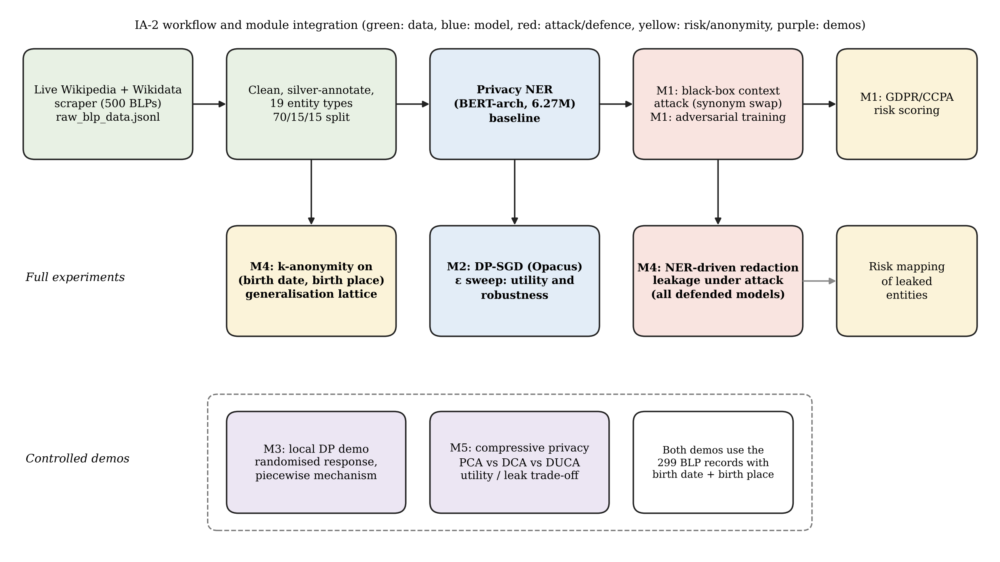
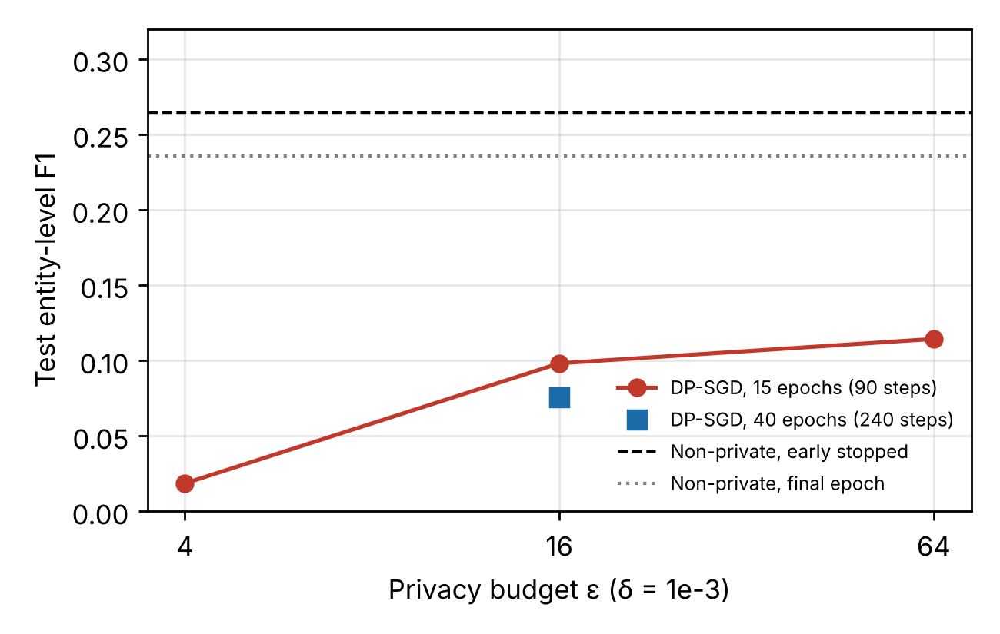
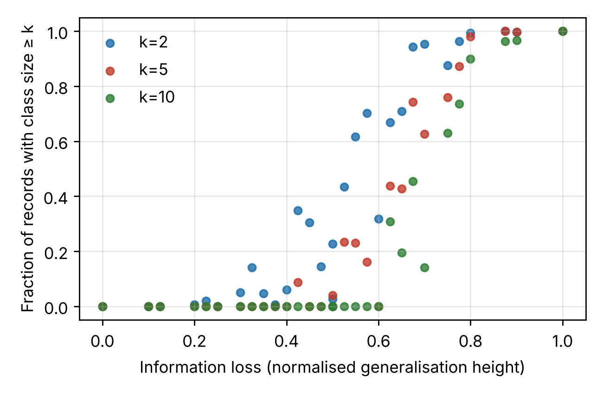
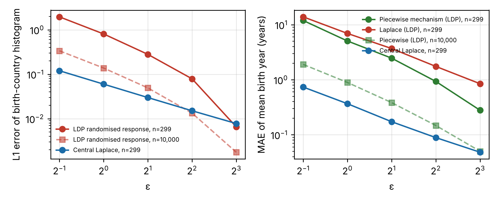
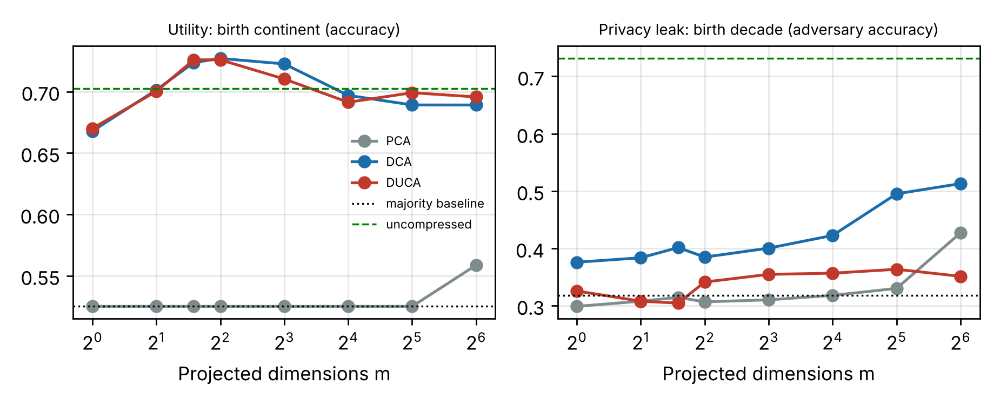

<div class="hdr">
<h1>Security and Privacy in Machine Learning</h1>
<div class="ia">IA2</div>
<div class="sub">Privacy-Preserving Defences for Adversarially Robust Privacy-Sensitive NER on Wikipedia Biographies of Living Persons</div>
<div class="college">KJ Somaiya School of Engineering</div>
<div class="nm"><span><b>Name</b>: Ayaan Banatwalla</span></div>
<div class="nm"><span><b>Roll No</b>: 16014223025</span></div>
<div class="gh"><b>Github:</b> <a href="https://github.com/ayaanbanatwalla-lab/wikipedia-blp-privacy-ner-adversarial">https://github.com/ayaanbanatwalla-lab/wikipedia-blp-privacy-ner-adversarial</a></div>
</div>

## 1. Problem Refinement and Objectives

**Revised problem statement.** Usecase: *To what extent do Wikipedia Biographies of Living Persons (BLPs) violate data protection regulations (GDPR, CCPA)?* IA-1 showed that the automated privacy-NER auditor needed to answer this can be degraded by small, meaning-preserving context edits. IA-2 asks the next question: **which privacy-preserving techniques from the course can protect the people described in a BLP corpus and the auditor itself, and what do they cost in accuracy and robustness?** Concretely, the study now covers three layers: (i) the *auditor model* (NER trained with and without differential privacy, and adversarially), (ii) the *redaction pipeline* that uses the auditor's output to mask personal data, and (iii) the *released structured data* (birth date and birthplace of each BLP).

**Revised objectives.**

1. Re-establish a reproducible baseline on the finalised dataset (Section 3) and keep IA-1's attack and adversarial-training results comparable to it.
2. **Module 2.** Train the NER model with DP-SGD at several privacy budgets and measure the utility and robustness cost against the non-private model.
3. **Module 4.** Measure how much personal data a NER-driven redaction pipeline leaves exposed, with and without the attack, and measure re-identification risk of the released birth-date and birthplace attributes with k-anonymity and generalisation.
4. **Module 3.** Demonstrate local differential privacy (randomised response and the piecewise mechanism) on the same attributes, and compare it with central DP.
5. **Module 5.** Demonstrate compressive privacy: a projection that keeps a utility attribute while hiding a sensitive one.
6. Report evaluation, limitations and reproducibility instructions in one technical report.

**Research questions.**

- **RQ1.** What accuracy does the NER auditor lose when trained with DP-SGD at each privacy budget, and does DP change its robustness to the attack?
- **RQ2.** How much personal data does NER-driven redaction leave exposed on clean text, and how much extra leaks under attack, for the baseline, adversarially trained and DP models?
- **RQ3.** How identifiable are BLPs from (birth date, birthplace), and what generalisation makes the release k-anonymous at what information loss?
- **RQ4.** How does estimation error under local DP compare with central DP on this data, and how well can a compressive-privacy projection separate utility from leakage?

**Technical requirements.** Python 3.13, PyTorch (CPU), Hugging Face Transformers and Tokenizers, Opacus (DP-SGD with RDP accounting), spaCy `en_core_web_sm`, WordNet 3.0, scikit-learn, NumPy/SciPy, Matplotlib. Everything runs on two CPU cores in under three hours end to end. All random seeds are fixed (42).

### Justification of changes from IA-1

| Item | IA-1 | IA-2 | Why it changed |
| --- | --- | --- | --- |
| Scope | Attack and defence on the NER model (Module 1 core) | Adds privacy-preserving training, redaction, anonymisation, LDP and compressive privacy | IA-1 mapped Modules 2 to 5 analytically and planned experiments for IA-2 |
| Baseline | Test F1 0.216 (P 0.163, R 0.323) | Test F1 0.235 (P 0.176, R 0.356) | Rebuilding the pipeline from the raw file after an environment reset exposed that the IA-1 run used a date-aware infobox matcher not present in the notebook cell. The matcher is now in the code (`common.py`) and the baseline is re-trained with the identical architecture and hyper-parameters. Numbers in IA-1 are kept as history and not mixed with IA-2 numbers |
| Defence comparison | Adversarial model (best-validation checkpoint) compared with a final-epoch baseline | Adversarial model compared with an **early-stopped baseline** as well | A final-epoch baseline is over-trained and makes early stopping look like an adversarial-training benefit |
| Redaction metric | Same-type entity flip | Adds a type-agnostic redaction check: is the target still covered by *any* predicted entity | A redactor masks any detected span, so type changes do not leak data |
| Module depth | M2 to M5 analytical | M2 and M4 full experiments; M3 and M5 controlled demonstrations | Agreed scope for the IA-2 deadline; the demonstrations use the same 299-record quasi-identifier table so they stay tied to the use case |
| Manuscript | Not required | The IEEE paper is updated as the manuscript; no separate IP draft | Agreed scope |

## 2. Integration of Course Concepts

### Final module-wise mapping

| Module | Technique used | Where it acts on the use case | Depth | Evidence |
| --- | --- | --- | --- | --- |
| 1. Privacy Consideration in ML | Black-box evasion attack, adversarial training, GDPR/CCPA risk scoring, privacy-oriented data mining (taxonomy) | The auditor is the ML system under attack; risk scoring turns misses into compliance impact | Implemented (IA-1), re-run on the final dataset | `08_adv_train.py`, `09_redaction_eval.py`, `results/adv_training_ia2.json` |
| 2. Differential Privacy | DP-SGD with per-sample clipping, Gaussian noise, RDP accounting (Opacus), epsilon sweep with ablation controls | Bounds what the NER model can reveal about any one biography | **Implemented and evaluated** | `dp.py`, `04_run_dp.py`, `04b_dp_controls.py`, `results/dpsgd_results.json` |
| 3. Local Differential Privacy | k-ary randomised response; piecewise mechanism (with Laplace as comparison) | Each BLP record is perturbed before any aggregation of birth country and birth year | **Controlled demonstration** | `06_ldp_demo.py`, `results/ldp_results.json` |
| 4. Privacy-Preserving Data Mining | NER-driven redaction (modifying the input), k-anonymity with generalisation hierarchies and suppression (publishing data) | Redaction of text; anonymised release of (birth date, birthplace) | **Implemented and evaluated** | `09_redaction_eval.py`, `05_kanonymity.py`, `results/redaction_eval.json`, `results/kanonymity_lattice.csv` |
| 5. Compressive Privacy | PCA, DCA and DUCA projections of paragraph features | Keeps birth continent (utility) while hiding birth decade (sensitive) | **Controlled demonstration** | `07_compressive_privacy.py`, `results/compressive_privacy.json` |

### Architecture and workflow



*Figure 1. Data flows from the live scraper to the NER model; Modules 2 and 4 attach to the model, the attack and the data; the Module 3 and 5 demonstrations use the same 299-record quasi-identifier table.*

### How the concepts are integrated

- **Module 1 to Module 2.** Adversarial training defends against *evasion*, a test-time attack. DP-SGD defends against *training-data leakage*. They answer different threats, so IA-2 evaluates DP models under the same evasion attack to see whether one defence affects the other.
- **Module 1 to Module 4.** The auditor's output is used to redact text. An evasion that stops a detection therefore becomes a *leak* in the redacted output. This links an ML-security result (attack success) to a privacy-preserving-data-mining result (residual exposure).
- **Module 4 to Modules 3 and 5.** After redaction, structured attributes such as birth date and birthplace remain. k-anonymity (Module 4), local DP (Module 3) and compressive privacy (Module 5) are three different ways to limit what those attributes reveal, so they are compared on the **same 299 records**.
- **Why Modules 3 and 5 are demonstrations, not full experiments.** Local DP needs many data holders to randomise their own values; compressive privacy needs a utility task and a privacy task with enough labelled data. With 299 records both are shown as controlled demonstrations with measured error, rather than as claims about production-scale performance. Section 4 states what each demonstration does and does not show.

## 3. Dataset Finalisation and Individual Implementation

### Final dataset and provenance record

The final dataset is the same **500 live-scraped English Wikipedia BLP intro paragraphs** as in IA-1, with the annotation refined as described below. No ready-made dataset is used.

| Attribute | Record |
| --- | --- |
| Name and version | `raw_blp_data.jsonl`, version 1 (single scrape, 500 retained of 641 candidates processed) |
| SHA-256 | `08303d7eca00bdf52defd7dec2813a9abb3e7af37734a64fddfc0f3269a5bc56` |
| Size | 524,423 bytes, 500 records, about 80 words per paragraph |
| Collection | Live scrape through the MediaWiki API and Wikidata API; file timestamp 7 October 2026 |
| Source and licence | English Wikipedia text under CC BY-SA 4.0 and Wikidata under CC0 (Wikimedia terms); non-commercial coursework use; every record keeps its source URL |
| Access restrictions | None beyond the licences. Only public Wikipedia content is used, only intro paragraphs and public infobox fields, and no private data was collected. Results are about a model and a method, not findings about any individual article |
| Derived files | `ner_train.jsonl` (350 records, SHA-256 `66e517b8e75a98fe...`), `ner_val.jsonl` (75, `eca19590b2e5192e...`), `ner_test.jsonl` (75, `e0b0937f899de514...`), `privbert_tokenizer-vocab.txt` (12,000 WordPiece tokens, `a8777893a1d198d9...`) |
| Sample used | All 500 records (70/15/15 article-level split, seed 42). One paragraph per person, so a record is also one data subject |
| Annotation status | Silver-standard (regex, spaCy `en_core_web_sm`, infobox cross-reference), `human_verified: false` |

**Refinement made in IA-2.** Infobox birth dates are ISO strings (for example `1964-02-22`) while article text writes `22 February 1964`. The matcher now converts each ISO date to the textual forms before cross-referencing. This yields **299 birth-date plus birthplace records** for Modules 3 to 5 and 325 `DATE_OF_BIRTH` spans in the annotation (train 234, validation 43, test 48).

**Data-quality issues found and handled.** Some infobox fields contain wiki markup (for example `U.S.{cite web`, external-link fragments, bracketed notes); `qi.py` cleans these before generalisation. Some infobox values are unusable (for example a spouse field holding a database title) and are not used as labels.

### Preprocessing scripts and final code

| File | Purpose |
| --- | --- |
| `scrape_wikipedia_blps.py` | Live scraper (IA-1): titles from Category:Living_people, extract and wikitext per page, Wikidata living-status check |
| `common.py` | Cleaning, silver annotation (including the date matcher), 70/15/15 split, tokenizer training, BIO alignment, model and metric code |
| `01_prepare_data.py` | Builds `ner_*.jsonl` and the tokenizer from `raw_blp_data.jsonl` |
| `02_train_baseline.py`, `02b_train_baseline_es.py` | Baseline (final epoch) and early-stopped baseline |
| `attack.py` | Black-box context-only attack and redaction check |
| `08_adv_train.py` | Adversarial training |
| `dp.py`, `04_run_dp.py`, `04b_dp_controls.py` | DP-SGD (Module 2) and controls |
| `05_kanonymity.py`, `qi.py` | k-anonymity lattice (Module 4) |
| `09_redaction_eval.py` | NER-driven redaction leakage (Module 4) |
| `06_ldp_demo.py` | Local DP demonstration (Module 3) |
| `07_compressive_privacy.py` | Compressive-privacy demonstration (Module 5) |
| `10_workflow_fig.py`, `build_ia2.py` | Workflow figure; builds this report's tables from the result files |

### Execution instructions

```
cd ia2                                         # all paths in this report are relative to the ia2/ folder of the repository
pip install torch transformers tokenizers spacy opacus scikit-learn scipy matplotlib nltk wn==0.0.23
python -m spacy download en_core_web_sm        # WordNet 3.0 must be available to nltk
python 01_prepare_data.py                      # data + tokenizer (about 1 min)
python 02_train_baseline.py                    # about 6 min on 2 CPU cores
python 02b_train_baseline_es.py
python 08_adv_train.py                         # about 20 min
python 04_run_dp.py 16,4,64 15 3e-3 64         # about 8 min per epsilon
python 04_run_dp.py 16 40 3e-3 64 _e40         # longer schedule, about 20 min
python 04b_dp_controls.py
python 09_redaction_eval.py ia2_baseline ia2_baseline_es ia2_adv_trained ia2_dp_eps16 ia2_dp_eps64
python 05_kanonymity.py ; python 06_ldp_demo.py ; python 07_compressive_privacy.py
python build_ia2.py
```

All outputs are written to `results/` and `figures/`. Seeds are fixed to 42; exact floating-point results can differ slightly across hardware and library versions.

### Individual contribution statement

This work was done individually by me: problem formulation (done with the help of my teacher), the live scraper, annotation pipeline and the date-matcher refinement, model training, the DP-SGD, adversarial-training, redaction, k-anonymity, local-DP and compressive-privacy experiments, the analysis, this report and the research paper.

## 4. Evaluation, Comparison and Critical Analysis

**Metrics.** NER: entity-level precision, recall and F1 with exact span and type match, on the 75-paragraph test split. Attack: of the entities the model detects correctly, the share whose same-type detection is removed (flip rate, with 95% Wilson interval), the mean drop in model confidence, and the **extra leak rate**, the share of correctly redacted privacy-relevant entities (PERSON plus the 15 privacy categories) that no longer have any predicted entity covering them after the attack. Redaction: **clean miss rate**, the share of gold privacy-relevant entities not covered by any predicted entity on clean text. DP: epsilon at fixed delta. k-anonymity: share of records in classes smaller than k and normalised generalisation height as information loss. LDP: L1 error of the country histogram and mean absolute error of the mean birth year, averaged over 500 randomisations. Compressive privacy: 5-fold, 3-seed cross-validated accuracy of a utility classifier and of a privacy adversary.

### 4.1 Baseline, adversarial training and attack (Module 1)

The attack is the IA-1 context-only black-box attack (at most 3 synonym substitutions, at most 60 queries, entity tokens never edited), re-run against each model on the test split.

| Model | Test F1 | P | R | Attackable entities | Flip rate (95% CI) | Extra leak, privacy entities | Mean confidence drop |
| --- | --- | --- | --- | --- | --- | --- | --- |
| Baseline (final epoch 25) | 0.235 | 0.176 | 0.356 | 239 | 2.9% (1.4% to 5.9%) | 4.5% | 0.450 |
| Baseline, early stopped (epoch 3) | 0.265 | 0.249 | 0.282 | 189 | 4.2% (2.2% to 8.1%) | 0.0% | 0.239 |
| Adversarially trained (epoch 3, 333 adversarial paragraphs added) | 0.290 | 0.256 | 0.335 | 225 | 2.7% (1.2% to 5.7%) | 0.0% | 0.316 |

*Early-stopped baseline versus adversarially trained: flip rates 4.2% versus 2.7%, Fisher exact p = 0.42.*

**Reading.** Adversarial training raises test F1 from 0.265 (early-stopped baseline) to 0.290 and the flip rate is lower, but the difference is **not statistically significant** (8 versus 6 flips). The mean confidence drop is actually *larger* for the adversarially trained model, which means its confidence is more fragile even where the final label survives. The honest conclusion is the same as in IA-1: full flips are rare for context-only edits with this model, and the evidence for an adversarial-training benefit is weak at this sample size.

### 4.2 Differential privacy: DP-SGD (Module 2)

Setting: per-sample gradient clipping norm C = 1.0, Gaussian noise, Poisson sampling at rate q = 1/6 (expected batch about 58), 15 epochs (90 steps) unless stated, AdamW with learning rate 3e-3, delta = 1e-3 (below 1/n = 1/350), RDP accountant. Because there is one paragraph per person, **example-level DP is person-level DP** here.

| Model | Epsilon | Noise multiplier | Test F1 | Test P | Test R | Attackable entities | Flip rate | Mean confidence drop |
| --- | --- | --- | --- | --- | --- | --- | --- | --- |
| Non-private baseline, early stopped (batch 16, lr 5e-4) | infinite | none | 0.265 | 0.249 | 0.282 | 189 | 4.2% | 0.239 |
| Same optimiser, no clipping, no noise | infinite | none | 0.000 | 0.000 | 0.000 | n/a | n/a | n/a |
| Same optimiser, clipping only | infinite | 0 | 0.000 | 0.000 | 0.000 | n/a | n/a | n/a |
| DP-SGD | 64 | 0.41 | 0.114 | 0.218 | 0.077 | 52 | 0.0% | 0.048 |
| DP-SGD | 16 | 0.76 | 0.098 | 0.227 | 0.063 | 42 | 0.0% | 0.008 |
| DP-SGD, 40 epochs (240 steps) | 16 | 1.02 | 0.076 | 0.185 | 0.048 | 32 | 0.0% | 0.027 |
| DP-SGD | 4 | 1.67 | 0.019 | 0.082 | 0.010 | 7 | 0.0% | 0.003 |



*Figure 2. Test F1 against privacy budget. The dashed lines are the non-private references.*

**Reading.** DP-SGD costs a lot of accuracy on this task: the best private model (epsilon 64, F1 0.114; epsilon 16, F1 0.098) is well under half of the non-private 0.265, and at epsilon 4 it learns almost nothing. Four observations qualify that number.

1. **The controls fail too.** With the same optimiser, batch size and 90-step schedule, the model trained *without* clipping and noise, and the one trained with clipping only, both reach F1 0.000: they are still predicting only the majority label `O` after 90 steps. The noisy runs escape that plateau. So part of the gap to the non-private baseline comes from the short schedule and the optimiser change that DP training needs, and the gap cannot be read as the pure cost of privacy.
2. **More steps did not help.** The 40-epoch run at epsilon 16 gives F1 0.076, lower than the 15-epoch run, because for a fixed epsilon the noise multiplier must grow with the number of steps (0.76 to 1.02). At epsilon 16 the model reaches a ceiling of roughly F1 0.1.
3. **Why the ceiling is low.** There are only 350 training paragraphs, a 39-label BIO task dominated by `O`, and a model trained from scratch with no pretrained knowledge, so per-step noise swamps the signal.
4. **The attack comparison is not reliable.** DP models correctly detect only 7 to 52 entities, so little remains to attack and no flips occur. DP-SGD should be read here as a privacy-of-training result, not a robustness result.

### 4.3 NER-driven redaction and k-anonymity (Module 4)

**Redaction leakage.** The redactor masks every span the NER model predicts. Privacy-relevant gold entities are PERSON plus the 15 privacy categories (317 instances in the test split).

| Model | Clean miss rate (privacy entities not covered) | Extra leak under attack (correctly redacted, then uncovered) | Mean confidence drop on privacy entities |
| --- | --- | --- | --- |
| Baseline (final epoch) | 57.4% (182 of 317) | 4.5% (n=66) | 0.296 |
| Baseline, early stopped | 66.9% (212 of 317) | 0.0% (n=61) | 0.098 |
| Adversarially trained | 59.6% (189 of 317) | 0.0% (n=69) | 0.220 |
| DP-SGD, epsilon 64 | 72.2% (229 of 317) | 0.0% (n=52) | 0.048 |
| DP-SGD, epsilon 16 | 74.1% (235 of 317) | 4.8% (n=42) | 0.009 |

**Reading.** The dominant leak is **not the attack**: even on clean text, the best model leaves 57.4% of privacy-relevant entities uncovered, and DP models leave 72.2% to 74.1%. The attack adds a small further leak (0 to 4.8% of the entities that were redacted). For this pilot, an under-trained auditor misses far more than an attacker can make it miss, so the first priority for a real GDPR/CCPA audit is recall, and robustness comes second.

**k-anonymity of the released attributes.** The quasi-identifiers are birth date and birthplace of the 299 BLPs that have both. Generalisation hierarchies: date (exact, month, year, 5-year band, decade, suppressed) and place (full, region and country, country, continent, suppressed). The lattice has 6 x 5 = 30 nodes; information loss is the normalised sum of generalisation levels.

| Release | Records unique | Smallest class size reached with at most 5% suppression | Information loss |
| --- | --- | --- | --- |
| Exact date and full place | 100.0% | 1 (no anonymity) | 0 |
| Year and place suppressed | 4.7% | k = 2 | 0.70 |
| 5-year band and place suppressed | 0.7% | k = 3 and k = 5 (suppress 2.0% for k = 5) | 0.80 |
| Date suppressed, continent kept | 0.0% | k = 10 (suppress 3.7%) | 0.88 |



*Figure 3. Each point is one of the 30 generalisation nodes. Higher information loss buys a larger share of records in classes of size at least k.*

**Reading.** **All 299 (birth date, birthplace) pairs are unique**, so a BLP is fully re-identifiable from them. With 299 records, meaningful k-anonymity needs heavy generalisation: the place must be dropped or reduced to a continent and the date reduced to a year or coarser. This is the classic small-sample limitation of k-anonymity and one reason the report also tests local DP and compressive privacy. k-anonymity also gives no protection against attribute linkage with other public sources, which is a limitation of the method.

### 4.4 Local differential privacy (Module 3, controlled demonstration)

Each record's birth country (top 8 countries plus Other) is perturbed with k-ary randomised response, and its birth year with the piecewise mechanism (with the Laplace mechanism as comparison), before aggregation. Central DP (Laplace on the aggregate) is the reference. Errors are averaged over 500 runs.

| Epsilon | Histogram L1 error, LDP randomised response (n = 299) | Histogram L1 error, central Laplace (n = 299) | Mean birth year error in years, piecewise (n = 299) | Laplace LDP (n = 299) | Piecewise (n = 10,000, bootstrap) |
| --- | --- | --- | --- | --- | --- |
| 0.5 | 1.951 | 0.120 | 11.93 | 13.91 | 1.90 |
| 1 | 0.805 | 0.060 | 5.07 | 6.95 | 0.89 |
| 2 | 0.280 | 0.030 | 2.47 | 3.69 | 0.38 |
| 4 | 0.079 | 0.015 | 0.93 | 1.75 | 0.15 |
| 8 | 0.007 | 0.008 | 0.28 | 0.85 | 0.05 |



*Figure 4. Error against epsilon for categorical and numeric attributes, on the real 299 records and on a 10,000-record bootstrap.*

**Reading.** At epsilon 0.5 the LDP histogram error is 1.951 (the maximum possible is 2), so the estimate is essentially noise; it falls below 0.1 only at epsilon 4. The piecewise mechanism beats Laplace for the numeric attribute at every epsilon, as expected from the theory. Local DP costs far more accuracy than central DP at the same epsilon because noise is added to every record rather than once to the aggregate, and the error shrinks roughly with the square root of n (10,000 records give about 6 times lower error). Local DP is only useful with a large user population, which a 500-page audit does not have. The 10,000-record rows are a bootstrap of the real values and show scaling, not new data.

### 4.5 Compressive privacy (Module 5, controlled demonstration)

Features are TF-IDF vectors of the paragraph text (years generalised to decade tokens), reduced to 100 dimensions. **Utility:** birth continent (4 classes, majority baseline 52.5%). **Privacy leak:** birth-decade group (4 classes, majority baseline 31.8%). PCA is unsupervised; DCA keeps directions that separate the utility classes; DUCA also penalises directions that separate the privacy classes.

| Representation | m | Utility accuracy | Privacy adversary accuracy |
| --- | --- | --- | --- |
| Uncompressed (100 dims) | 100 | 70.2% | 73.1% |
| PCA | 1 | 52.5% | 29.9% |
| PCA | 3 | 52.5% | 31.4% |
| PCA | 8 | 52.5% | 31.0% |
| PCA | 64 | 55.9% | 42.7% |
| DCA | 1 | 66.8% | 37.6% |
| DCA | 3 | 72.4% | 40.1% |
| DCA | 8 | 72.3% | 40.0% |
| DCA | 64 | 68.9% | 51.3% |
| DUCA | 1 | 67.0% | 32.6% |
| DUCA | 3 | 72.6% | 30.4% |
| DUCA | 8 | 71.0% | 35.5% |
| DUCA | 64 | 69.6% | 35.1% |



*Figure 5. Left: utility accuracy; right: accuracy of an adversary predicting birth decade, against projected dimensions m.*

**Reading.** The uncompressed features leak the birth decade (73.1% against a 31.8% majority baseline) and support the utility task at 70.2%. DUCA with m = 3 reaches utility 72.6% while pushing the adversary to 30.4%, which is about the majority baseline, so on this data the projection keeps the utility signal and removes the decade signal. PCA at small m keeps neither signal. The result is from 299 records with cross-validation, so the gaps of a few points are within noise; the large gaps (leakage 73.1% to about 30.4%) are the finding. It is a demonstration that the method works as a utility/privacy trade-off tool, not a claim about general text.

### 4.6 Privacy-utility summary and critical analysis

| Technique | Privacy gain | Utility cost | Main caveat |
| --- | --- | --- | --- |
| Adversarial training (M1) | Lower flip rate, not significant | F1 up with early stopping | Confidence is more fragile; small sample |
| DP-SGD (M2) | Formal epsilon bound for each BLP | F1 0.098 at epsilon 16 against 0.265 non-private | Tiny data; short schedule confound; attack metrics unreliable |
| k-anonymity (M4) | 100% unique down to k of 2 to 10 | Place dropped, date coarsened | Small-sample; linkage attacks remain |
| LDP (M3) | No trusted collector needed | Error of 0.8 L1 at epsilon 1 | Needs a large population |
| Compressive privacy (M5) | Decade leakage 73.1% to about 30.4% | Utility 70.2% to 72.6% (no loss) | Small data; one utility and one privacy task |

**Limitations.** (1) Silver-standard labels: all F1 numbers measure agreement with weak labels, not truth. (2) 75 test paragraphs: confidence intervals are wide and the 15 privacy categories have near-zero support apart from `DATE_OF_BIRTH` (48), `EMPLOYMENT` (12), `NATIONALITY` (4) and `FINANCIAL` (2). (3) The DP runs use different optimiser settings from the non-private baseline (larger batches, higher learning rate, fewer steps) because DP needs them to learn at all; the matched non-private controls fail under those settings, so the privacy cost cannot be isolated exactly. (4) Single seed per configuration. (5) The attack is context-only and limited to 3 substitutions, so low flip rates do not prove robustness to stronger attacks. (6) The Module 3 and 5 results are demonstrations on one small table.

**Improvements.** Human-verified labels for the privacy categories; a larger scrape (the scraper already supports 5,000 to 10,000 pages); a pretrained encoder fine-tuned with DP-SGD (the main fix for the utility loss); repeated seeds with confidence intervals; stronger attacks including entity-adjacent edits; and releasing structured attributes with differentially private aggregate statistics rather than record-level k-anonymity.

## 5. Final Documentation and Research Outcome

### Conclusions

1. **Answer to the use case at this scale.** An automated privacy auditor built the way a real audit would be built (a NER model over live Wikipedia text) is limited more by recall than by attack: on clean text it leaves at least 57.4% of privacy-relevant entities uncovered, and context-only attacks add a few percentage points of extra leakage.
2. **Module 2.** DP-SGD gives a formal per-person bound but at this data scale it costs most of the model's accuracy (F1 0.098 at epsilon 16 versus 0.265), so privacy-preserving training is only practical here with a pretrained encoder or much more data. The accuracy gap cannot be fully attributed to privacy, because the matched non-private controls with the same short schedule also failed (F1 0.000).
3. **Module 4.** Every BLP is unique under (birth date, birthplace); k-anonymity of 5 or more needs the date coarsened to a 5-year band and the place removed.
4. **Module 3.** Local DP needs thousands of records to be useful; at 299 records its error is large.
5. **Module 5.** A discriminant projection can keep a utility attribute and remove a sensitive one: leakage fell from 73.1% to about 30.4% with no utility loss on this data.

### Reproducibility

Raw data hash, derived-file hashes, seeds, library versions and run order are recorded in Section 3 and in the repository README. Every table in this report is generated by `build_ia2.py` from the files in `results/`, so no number is typed by hand. Pretrained weights are not used; the model and tokenizer are trained from scratch. Three representative checkpoints (`ia2_baseline_es`, `ia2_adv_trained`, `ia2_dp_eps16`) are in `models/` as zip files; the other checkpoints are regenerated by the scripts.

### Research outcome

The updated IEEE paper (Section "Privacy-Preserving Extensions") is the manuscript for this work; no separate IP draft was prepared.

### References

1. Regulation (EU) 2016/679 (GDPR), 2016.
2. California Consumer Privacy Act of 2018 and CPRA amendments (CCPA), 2020.
3. M. Abadi et al., "Deep learning with differential privacy," ACM CCS, 2016.
4. A. Yousefpour et al., "Opacus: user-friendly differential privacy library in PyTorch," 2021.
5. L. Sweeney, "k-anonymity: a model for protecting privacy," Int. J. Uncertainty, Fuzziness and Knowledge-Based Systems, 2002.
6. T. Wang et al., "Collecting and analyzing multidimensional data with local differential privacy," IEEE ICDE, 2019.
7. S. Y. Kung, "Compressive privacy: from information/estimation theory to machine learning," IEEE Signal Processing Magazine, 2017.
8. D. Jin et al., "Is BERT really robust? A strong baseline for natural language attack on text classification and entailment," AAAI, 2020.
9. L. Li et al., "BERT-Attack: adversarial attack against BERT using BERT," EMNLP, 2020.
10. R. Shokri et al., "Membership inference attacks against machine learning models," IEEE S&P, 2017.
11. Wikipedia, "Biographies of living persons" policy and Category:Living_people.

## Evidence Index

| Rubric stage | Evidence | Path in repository |
| --- | --- | --- |
| 1. Problem refinement and objectives | Revised statement, objectives, research questions, requirements, change justification | Section 1 |
| 2. Integration of course concepts | Module mapping table, workflow diagram, evidence per module | Section 2; `figures/fig_workflow.png`; `results/dpsgd_results.json`, `results/redaction_eval.json`, `results/kanonymity_lattice.csv`, `results/ldp_results.json`, `results/compressive_privacy.json` |
| 3. Dataset finalisation and implementation | Provenance record, hashes, preprocessing and final code, execution instructions, contribution statement | Section 3; `raw_blp_data.jsonl`; `common.py`, `01_prepare_data.py` and the scripts listed in Section 3 |
| 4. Evaluation, comparison and critical analysis | Metrics, baseline and adversarial comparison, DP sweep and controls, redaction, k-anonymity, LDP, compressive privacy, limitations | Section 4; `results/*.json`, `results/*.csv`; `figures/fig_dp.png`, `fig_kanon.png`, `fig_ldp.png`, `fig_cp.png` |
| 5. Final documentation and research | Conclusions, reproducibility, references, updated manuscript | Section 5; `paper/research_paper.pdf` |
